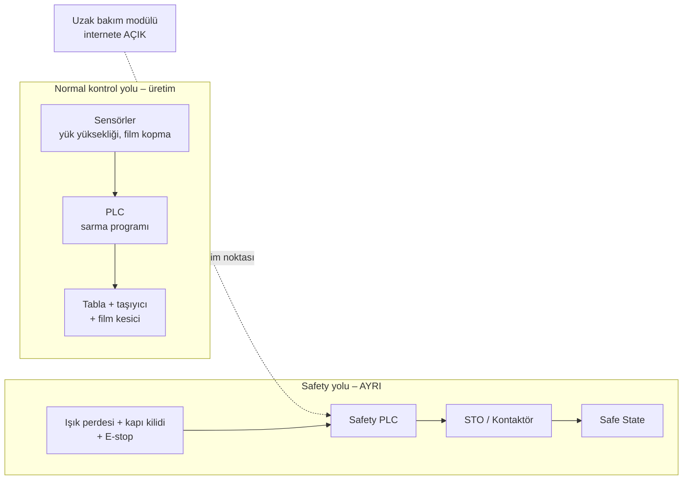

# Lab 1 – Safety Architecture

**Makine:** Argesta Döner Tablalı Palet Streç Sarma · **Çıktı:** Safety Function Map → EP 03 Safety Functions

## Safety Function Map

## Cevaplar

**1. Bu makinede tehlike nedir? İnsan neyden zarar görür?**
Döner tabla, yukarı-aşağı hareket eden film taşıyıcı ve film kesme bıçağı. Operatör kopan filmi bağlarken veya film rulosunu değiştirirken eli/kolu sıkışabilir, tablaya çarpılabilir ya da kesilebilir. Kötü sarılan yük devrilebilir.

**2. Safety function hangisidir?**
Işık perdesi kesildiğinde, kapı açıldığında veya E-stop'a basıldığında tabla, taşıyıcı ve kesici STO ile durur; reset yapılmadan yeniden başlamaz.

**3. Safety-related control system nerede?**
Alt şerit: ışık perdesi + kapı kilidi + E-stop → Safety PLC → STO / kontaktör.

**4. Normal PLC ile Safety PLC farkı nedir?**
Normal PLC sarma programını, tur sayısını ve film gerginliğini yönetir; tek kanallıdır. Safety PLC çift kanallıdır, kendini test eder, hata görünce güvenli duruma geçer ve sertifikalıdır.

**5. PLr / SIL neden var? Bu fonksiyon için neden önemli?**
Fonksiyonun ne kadar güvenilir olacağını riske göre belirler. Operatör film işlemleri için makineye sık girer ve yaralanma ağır olabilir → **PLr d**.

**6. Safe state nedir?**
Tabla ve taşıyıcı durur, taşıyıcı frenle olduğu yerde kalır (düşmez), makine kendiliğinden yeniden başlamaz.

**7. Safety function hangi dijital bağımlılıklara sahip?**
Safety PLC programı, ışık perdesi muting ayarları, STO ve sürücü parametreleri, HMI, uzak bakım modülü.

**8. Siber müdahale hangi noktadan bu fonksiyonu bozar?**
Uzak bakım modülü → Safety PLC. Saldırgan muting ayarını değiştirip ışık perdesini devre dışı bırakırsa operatör içerideyken tabla döner.
