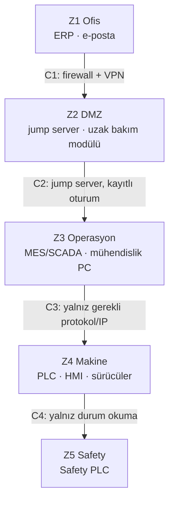

# Lab 2 – IEC 62443 Mini Workshop

**Makine:** Argesta Döner Tablalı Palet Streç Sarma · **Çıktı:** Zone / Conduit Diagram → EP 05 Zone & Conduit

## Zone / Conduit Diagram

## Görev A

**1. Hangi varlıklar aynı bölgede?**
- **Z1 Ofis:** ERP, e-posta
- **Z2 DMZ:** Jump server, uzak bakım modülü
- **Z3 Operasyon:** MES/SCADA, mühendislik PC'si
- **Z4 Makine:** PLC, HMI, sürücüler
- **Z5 Safety:** Safety PLC

**2. Safety PLC hangi bölgede – neden?**
Ayrı bölgede (Z5). Operatörü dönen tablaya karşı korur; diğer bölgeler ele geçirilse bile ona ulaşılamamalı.

**3. Conduit'ler nerede, ne kontrol edilecek?**
- **C1 Ofis ↔ DMZ:** Firewall + VPN, ofisten makineye doğrudan yol yok.
- **C2 DMZ ↔ Operasyon:** Jump server, MFA, kayıtlı oturum.
- **C3 Operasyon ↔ Makine:** Sadece gerekli protokol ve izinli IP'ler.
- **C4 Makine ↔ Safety:** Sadece durum okuma, uzaktan program yükleme kapalı.

## Görev B – Uzak erişim kararı

| Karar | Seçim | Neden |
|---|---|---|
| Aracı | Jump server | Modül internete doğrudan açık kalmaz |
| Tünel | VPN | Şifreli bağlantı |
| Kimlik | MFA | Çalınan parola tek başına yetmez |
| Hesap | Kişisel | Kimin ne yaptığı izlenir |
| Kayıt | Tam oturum kaydı | Olayda kanıt olur |
| Zamanlama | Varsayılan kapalı | Sadece bakım sırasında açılır |
