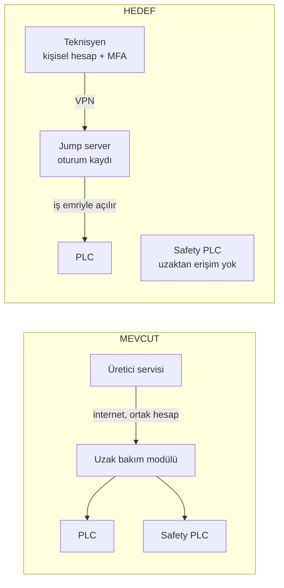

# Lab 4 – Secure Remote Access

**Makine:** Argesta Döner Tablalı Palet Streç Sarma · **Çıktı:** Secure Architecture → EP 02 + EP 06

## Görev A – Mevcut → Hedef

**MEVCUT:**
- Üretici internete açık uzak bakım modülüne ortak servis hesabıyla bağlanıyor.
- MFA yok, oturum kaydı yok, erişim 7/24 açık.
- Modülden Safety PLC'ye ulaşılabiliyor.

**HEDEF (beş ilke):**
1. Ara nokta: bağlantı jump server üzerinden.
2. VPN: şifreli bağlantı.
3. MFA.
4. Kişisel hesap + tam oturum kaydı.
5. Varsayılan kapalı: sadece iş emriyle, süre sınırlı açılır.

## Görev B – Functional safety köprüsü

**1. Saldırgan tüm önlemlere rağmen içeri girerse emniyet fonksiyonu etkilenir mi?**
Safety yolu ayrıysa etkilenmez: ışık perdesi → Safety PLC → STO zinciri tablayı ve taşıyıcıyı yine durdurur. Safety PLC'ye uzaktan erişim açıksa etkilenir.

**2. Gereksinim:**
"Emniyet fonksiyonu, kontrol sistemi veya uzak erişim ele geçirilse bile tablayı ve taşıyıcıyı durdurabilmeli. Safety ayarları yalnızca sahada ve yetkiyle değiştirilebilmeli."

> Tarafsızlık notu: Bu föy çözüm tasarlatmaz; gereksinimi tanımlatır.
