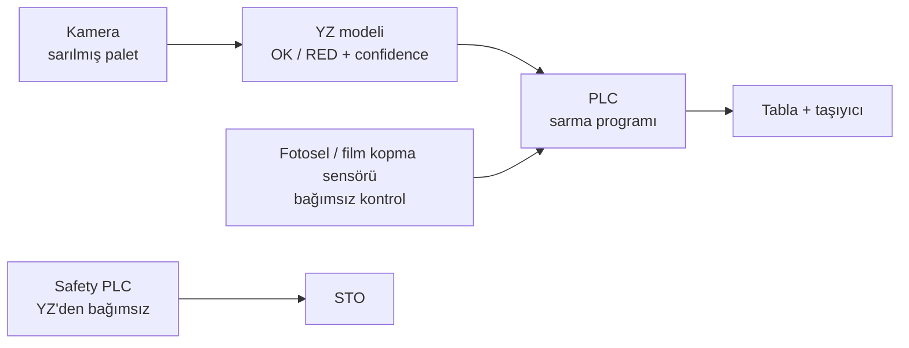

# Lab 7 – AI Safety Challenge

**Makine:** Argesta Döner Tablalı Palet Streç Sarma · **Çıktı:** AI Fail-Safe Decision

## Senaryo

Sarma çıkışındaki kamera paleti inceler; YZ modeli **OK / RED** kararı verir ve sarma programını (tur sayısı, film gerginliği) ayarlar.

**Temel ilke:** YZ yalnızca kalite kararı verir; emniyet fonksiyonuna (ışık perdesi → Safety PLC → STO) erişemez, sürücü hız sınırlarını aşamaz.

## Sorular

**1. Model yanlış sınıflandırırsa ne olur?**
Gevşek sarılmış palet OK geçerse forkliftte yük devrilebilir. Önlem: fotosel ve film kopma sensörüyle bağımsız ikinci kontrol yapılır; sonuçlar çelişirse palet RED olur ve operatör onaylar.

**2. Girdi manipüle edilirse (sahte/donmuş görüntü, kameraya müdahale)?**
Kare zaman damgası ve donmuş kare kontrolü yapılır, görüntü fotosel verisiyle karşılaştırılır. Uyuşmazlıkta palet RED olur ve ayrılır; tekrarlarsa makine kontrollü durur ve alarm verilir.

**3. Confidence düşükse ne yapılır?**

| Confidence | Karar |
|---|---|
| ≥ 0,95 | Otomatik karar |
| 0,80 – 0,95 | Operatöre sorulur |
| < 0,80 | Standart sarma programı (fallback), palet RED |

Düşük güvenli kararlar sıklaşırsa model devre dışı bırakılır, klasik kontrole geçilir.

## Karar tablosu

| Arıza modu | Seçilen önlem |
|---|---|
| Yanlış sınıflandırma | Fail-safe (şüphede RED) + human override |
| Manipüle girdi | Monitoring + fail-safe |
| Düşük confidence | Confidence threshold + fallback |

> Sonuç: YZ hata yaparsa kalite düşebilir ama insan emniyeti etkilenmez; emniyet her zaman YZ'den bağımsız Safety PLC'dedir.
